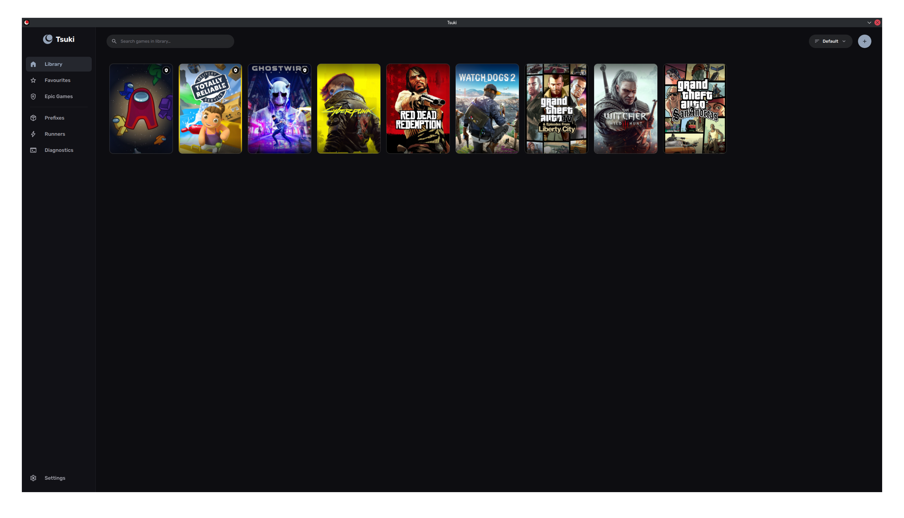
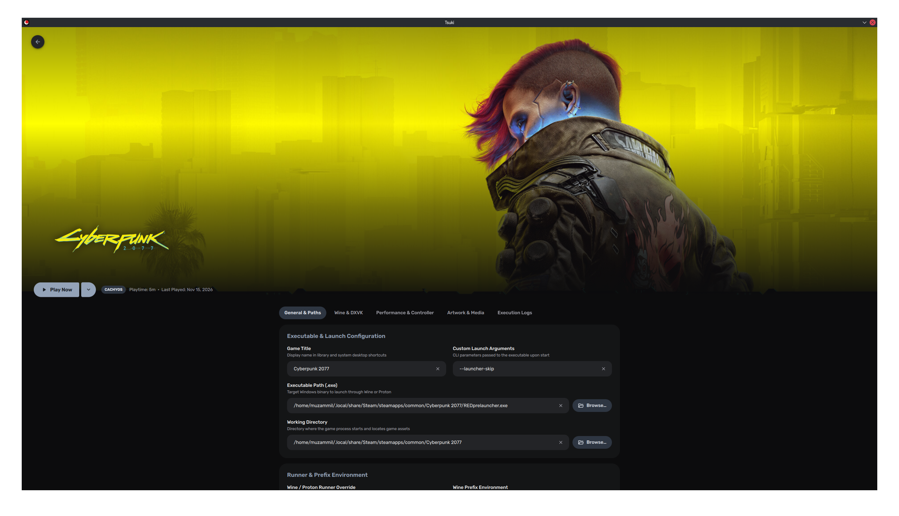

# Tsuki

A Linux game launcher for Wine, Proton, native Linux games, and the Epic Games Store, written in C++20 and Qt 6 / QML.

## Screenshots





## Features

- Manage Windows games (Wine / Proton), native Linux games, and Epic Games titles in one library
- **Native Epic Games Store integration** (100% C++20/Qt6 — zero `QtWebEngine` or external CLI required):
  - External-browser OAuth token sign-in and persistent session refresh
  - Native binary/JSON manifest parsing and multi-threaded zlib/SHA-1 chunk downloading, pause/resume, and file verification
  - **Import existing installations** (e.g. Heroic Games Launcher folders) with **Copy**, **Move**, or **Keep in Place** transfer modes, runner/prefix selection, and optional disk cleanup when uninstalling
  - Online multiplayer support via OAuth exchange codes, native **EOS Social Overlay** installation & prefix registry management, and toggleable Epic library badges
- Download and manage Proton-GE and Proton-CachyOS runners, or use system Wine and Steam Proton installations
- Auto-detect or 1-click install **Proton EasyAntiCheat (EAC)** and **BattlEye** anti-cheat runtimes
- Create, clone, back up, and restore isolated Wine prefixes
- Built-in Winetricks component installer
- Automatic cover, banner, logo, and icon fetching via SteamGridDB
- Virtual Xbox 360 controller emulation over `/dev/uinput` (with udev rule included)
- Optional MangoHud, Feral GameMode, and Gamescope microcompositor integration
- System diagnostics and per-game launch logs
- Full Keyboard & Gamepad navigation support across the launcher (PlayStation and Xbox prompts)

## Installation

### Arch Linux

**From GitHub Releases (`.pkg.tar.zst`)**

Download the latest `.pkg.tar.zst` from the [Releases](https://github.com/muzammilshafique/tsuki/releases) page and install it:

```bash
sudo pacman -U ./tsuki-*.pkg.tar.zst
```

**From the AUR**

```bash
# Prebuilt binary from the latest GitHub release
yay -S tsuki-bin

# Build from the latest git commit
yay -S tsuki-git
```

Support is also provided for **AppImage**, **Ubuntu / Debian (`.deb`)**, and **Fedora (`.rpm`)**:

### AppImage (Universal Linux)

Download the `.AppImage` from the [Releases](https://github.com/muzammilshafique/tsuki/releases) page (works on most distributions including Ubuntu 22.04+, Debian 12+, Fedora, Arch, and SteamOS):

```bash
chmod +x ./Tsuki-*-x86_64.AppImage
./Tsuki-*-x86_64.AppImage
```

### Ubuntu / Debian

Download the `.deb` package from the [Releases](https://github.com/muzammilshafique/tsuki/releases) page (requires Qt 6.8+, e.g. Ubuntu 25.10+ / 26.04 LTS or Debian 13 Trixie) and install it:

```bash
sudo apt install ./tsuki_*_amd64.deb
```

### Fedora

Download the `.rpm` package from the [Releases](https://github.com/muzammilshafique/tsuki/releases) page and install it:

```bash
sudo dnf install ./tsuki-*.x86_64.rpm
```

## Building from Source

### Dependencies

**Arch Linux:**

```bash
sudo pacman -S cmake ninja pkgconf qt6-base qt6-declarative qt6-svg sdl2 zlib hicolor-icon-theme tar
```

**Ubuntu / Debian:**

```bash
sudo apt install cmake ninja-build pkg-config g++ qt6-base-dev qt6-declarative-dev qt6-svg-dev qt6-qpa-plugins qt6-svg-plugins libqt6sql6-sqlite qml6-module-qtquick qml6-module-qtquick-controls qml6-module-qtquick-layouts qml6-module-qtquick-effects libsdl2-dev zlib1g-dev libgl-dev hicolor-icon-theme tar
```

**Fedora:**

```bash
sudo dnf install cmake ninja-build gcc-c++ pkgconf-pkg-config qt6-qtbase-devel qt6-qtdeclarative-devel qt6-qtsvg-devel 'pkgconfig(sdl2)' 'pkgconfig(zlib)' hicolor-icon-theme tar
```

Optional runtime packages: `wine`, `winetricks`, `mangohud`, `gamemode`, `gamescope`, `7zip` (`p7zip`), `vulkan-icd-loader` (`vulkan-tools` / `vulkan-loader`), and `ttf-jetbrains-mono-nerd` (Arch).

### Build, Test, and Install

```bash
cmake -B build -G Ninja -DCMAKE_BUILD_TYPE=Release -DCMAKE_INSTALL_PREFIX=/usr -DCMAKE_INSTALL_LIBDIR=lib
cmake --build build
ctest --test-dir build --output-on-failure
sudo cmake --install build
```

## License

Licensed under the [GNU General Public License v3.0 or later](LICENSE).

