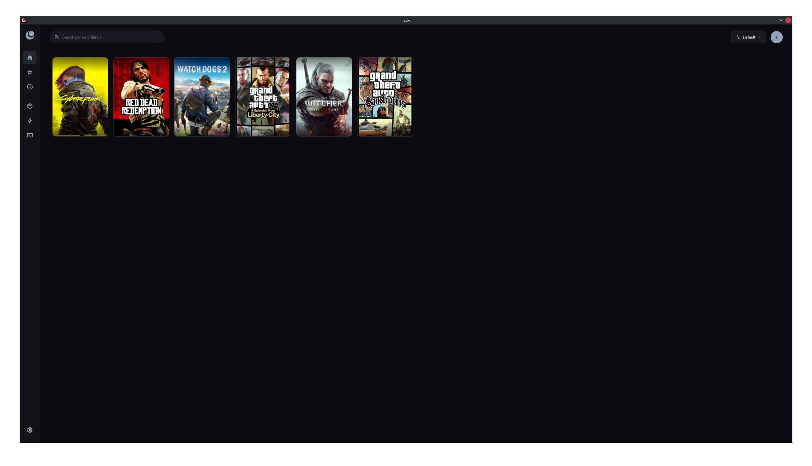
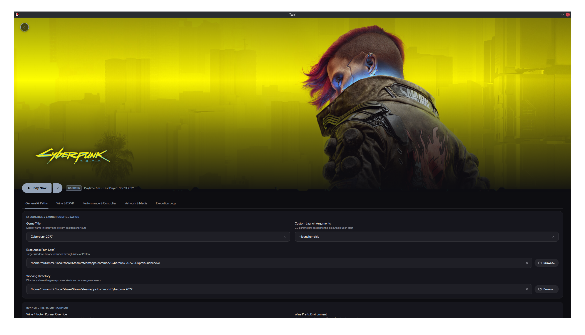

# Tsuki

A Linux game launcher for Wine, Proton, and native Linux games, written in C++20 and Qt 6 / QML.

## Screenshots





## Features

- Manage Windows games (Wine / Proton) and native Linux games in one library
- Download and manage Proton-GE and Proton-CachyOS runners, or use system Wine
- Create, clone, back up, and restore isolated Wine prefixes
- Built-in Winetricks component installer
- Automatic cover, banner, logo, and icon fetching via SteamGridDB
- Virtual Xbox 360 controller emulation over `/dev/uinput` (with udev rule included)
- Optional MangoHud and Feral GameMode integration
- System diagnostics and per-game launch logs
- Proper Gamepad navigation support for the app (supports PS and Xbox gamepad)

## Installation

### Arch Linux

**From GitHub Releases (`.pkg.tar.zst`)**

Download the latest `.pkg.tar.zst` from the [Releases](https://github.com/muzammilshafique/tsuki/releases) page and install it:

```bash
sudo pacman -U ./tsuki-*.pkg.tar.zst
```

**From the AUR**

```bash
# Prebuilt binary from the latest GitHub release
yay -S tsuki-bin

# Build from the latest git commit
yay -S tsuki-git
```

Support for Ubuntu/Debian (`.deb`) and Fedora (`.rpm`) will be added later.

## Building from Source

### Dependencies (Arch Linux)

```bash
sudo pacman -S cmake ninja pkgconf qt6-base qt6-declarative qt6-svg sdl2 hicolor-icon-theme tar
```

Optional runtime packages: `wine`, `winetricks`, `mangohud`, `gamemode`, `7zip`, `vulkan-icd-loader`.

### Build, Test, and Install

```bash
cmake -B build -G Ninja -DCMAKE_BUILD_TYPE=Release -DCMAKE_INSTALL_PREFIX=/usr -DCMAKE_INSTALL_LIBDIR=lib
cmake --build build
ctest --test-dir build --output-on-failure
sudo cmake --install build
```

## License

Licensed under the [GNU General Public License v3.0 or later](LICENSE).

