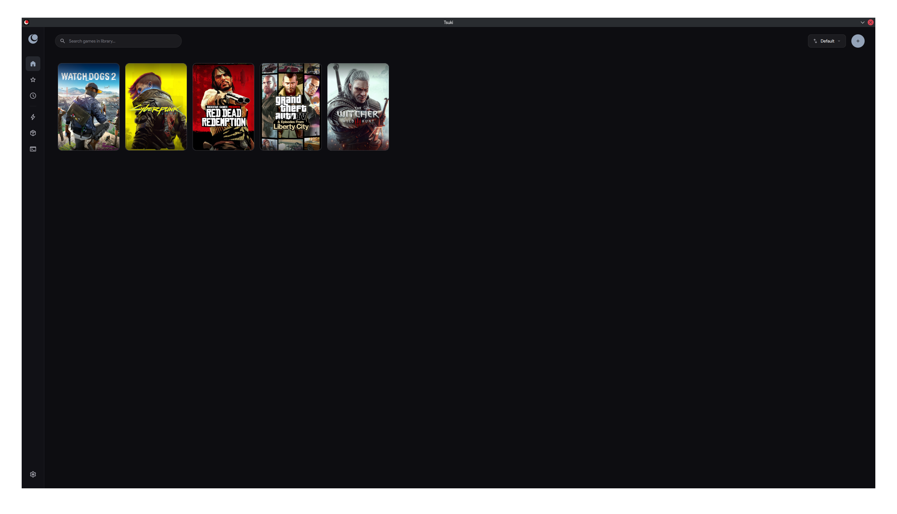
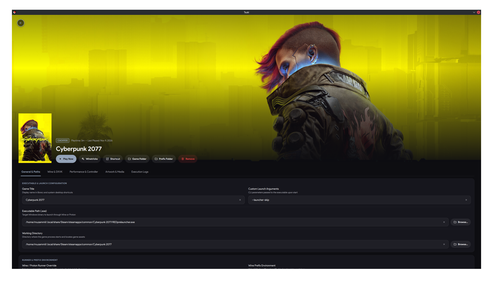

# Tsuki 🌙

**Native Linux Game Launcher for Wine, Proton, and Native Titles**

[](https://github.com/muzammilshafique/tsuki/actions/workflows/ci.yml)
[](https://github.com/muzammilshafique/tsuki/actions/workflows/release.yml)
[](LICENSE)

Tsuki is a fast, native Linux game launcher designed specifically for running Windows and native Linux games. Built with modern C++20 and Qt 6 / QML, Tsuki delivers a lightweight, responsive interface without the overhead of heavy web frameworks.

---

## Features

- **Blazing Fast Native UI**: Responsive fluid interface built with Qt 6 Quick and QML.
- **Proton & Wine Runner Management**: In-app Proton-GE downloader, automatic system Wine detection, and per-game runner assignment.
- **Isolated Wine Prefix Management**: Create, clone, backup (`.tar.gz`), and restore isolated Wine prefixes effortlessly.
- **Built-in Winetricks Catalog**: Install Windows components (DirectX, Visual C++ runtimes, .NET) with progress reporting and automatic Winetricks bootstrapping.
- **Artwork & Metadata**: Automatic grid, hero banner, logo, and icon fetching via SteamGridDB.
- **Kernel-Level Xbox 360 Controller Emulation**: Standalone `/dev/uinput` virtual gamepad driver maps generic or non-XInput controllers into a native Xbox 360 controller recognized by Wine and Proton games.
- **Performance Tooling**: First-class integration with MangoHud overlay and Feral GameMode.
- **Diagnostics & Troubleshooting**: Built-in system integrity checks for Vulkan ICDs, 32-bit multilib libraries, and live Wine execution logs.

---

# Screenshots

<p align="center">
  
</p>

<p align="center">
  
</p>

---

## Installation

Pre-built binaries and native packages for x86_64 are available on the [GitHub Releases](https://github.com/muzammilshafique/tsuki/releases) page for every release.

### 1. Universal Linux (`.AppImage`)

The universal AppImage runs on virtually any modern Linux distribution without installation:

```bash
# 1. Download Tsuki-<version>-x86_64.AppImage from Releases
# 2. Make it executable:
chmod +x Tsuki-*-x86_64.AppImage

# 3. Launch Tsuki:
./Tsuki-*-x86_64.AppImage
```

*(Optional)* You can integrate the AppImage into your desktop application menu using tools like [Geary AppImageLauncher](https://github.com/TheAssassin/AppImageLauncher) or by moving it to `~/.local/bin/`.

---

### 2. Debian / Ubuntu (`.deb`)

Native `.deb` packages are provided for Debian 12+, Ubuntu 22.04+, Linux Mint, and derivatives:

```bash
# Install package and resolve dependencies
sudo apt update
sudo apt install ./tsuki_*_amd64.deb
```

To remove:
```bash
sudo apt remove tsuki
```

---

### 3. Fedora / RHEL (`.rpm`)

Native `.rpm` packages are provided for Fedora 39+, RHEL 9+, and compatible distributions:

```bash
# Install package and resolve dependencies
sudo dnf install ./tsuki-*.x86_64.rpm
```

To remove:
```bash
sudo dnf remove tsuki
```

---

### 4. Arch Linux / Manjaro (`.pkg.tar.zst`)

Native Arch Linux packages are built using `makepkg`:

```bash
# Install package and dependencies
sudo pacman -U ./tsuki-*.pkg.tar.zst
```

To remove:
```bash
sudo pacman -R tsuki
```

---

## 🎮 Controller Emulation & `/dev/uinput` Permissions

Tsuki includes a standalone virtual Xbox 360 controller driver that feeds events directly to the Linux kernel via `/dev/uinput`. This gives Wine and Proton games native XInput controller support for gamepads that otherwise lack compatibility.

### Least-Privilege Security Design

- **No Root Required**: You should **never** run Tsuki or games as `root`.
- **No World-Writable Permissions**: Setting `/dev/uinput` to `0666` (world-writable) is insecure because any background process could inject malicious keystrokes.
- **Systemd Session ACLs (`TAG+="uaccess"`)**: Tsuki uses systemd-logind's seat management. The udev rule dynamically grants read/write permissions **only to the user physically logged into the active desktop session**.

### Automatic Configuration

The `.deb`, `.rpm`, and `.pkg.tar.zst` packages automatically install the udev rule (`/usr/lib/udev/rules.d/70-tsuki-uinput.rules`) and reload the udev subsystem during package installation.

### Manual Configuration (AppImage / Standalone)

If you are running the AppImage or compiling from source, install the udev rule manually once:

```bash
# 1. Download or install the udev rule
sudo tee /etc/udev/rules.d/70-tsuki-uinput.rules << 'EOF'
KERNEL=="uinput", SUBSYSTEM=="misc", OPTIONS+="static_node=uinput", TAG+="uaccess", MODE="0660", GROUP="input"
EOF

# 2. Ensure uinput kernel module is loaded
sudo modprobe uinput
echo "uinput" | sudo tee /etc/modules-load.d/tsuki-uinput.conf

# 3. Reload udev rules and trigger device node
sudo udevadm control --reload-rules
sudo udevadm trigger /dev/uinput
```

Verify that your user has access:
```bash
getfacl /dev/uinput
```
You should see `user:<your-username>:rw-`. You can also verify controller emulation status inside Tsuki's **Diagnostics** tab.

---

## Desktop Integration

Installed packages conform to FreeDesktop and AppStream standards:
- **Application Binary**: `/usr/bin/tsuki`
- **Desktop Launchers**: 
  - `/usr/share/applications/io.github.muzammilshafique.tsuki.desktop`
  - `/usr/share/applications/tsuki.desktop`
- **AppStream Metadata**: `/usr/share/metainfo/io.github.muzammilshafique.tsuki.metainfo.xml`
- **MIME Associations**: `/usr/share/mime/packages/tsuki.xml` (registers `x-scheme-handler/tsuki`)
- **Theme Icons**: Standard Hicolor icons at 16x16, 24x24, 32x32, 48x48, 64x64, 128x128, 256x256, 512x512, plus scalable SVG.
- **Udev Rule**: `/usr/lib/udev/rules.d/70-tsuki-uinput.rules`

---

## Building from Source

### Requirements

- Modern C++20 compiler (`gcc` >= 11 or `clang` >= 14)
- CMake >= 3.24
- Ninja or Make
- SDL2 development libraries
- Qt 6 (Core, Gui, Widgets, Qml, Quick, QuickControls2, Sql, Network, Svg, Concurrent, Test)

#### Install Dependencies:

- **Ubuntu / Debian**:
  ```bash
  sudo apt install cmake ninja-build build-essential pkg-config \
    qt6-base-dev qt6-declarative-dev libqt6svg6-dev libsdl2-dev
  ```
- **Fedora**:
  ```bash
  sudo dnf install cmake ninja-build gcc-c++ pkgconfig \
    qt6-qtbase-devel qt6-qtdeclarative-devel qt6-qtsvg-devel SDL2-devel
  ```
- **Arch Linux**:
  ```bash
  sudo pacman -S cmake ninja pkgconf qt6-base qt6-declarative qt6-svg sdl2
  ```

### Build & Run Tests

```bash
# 1. Configure
cmake -B build -G Ninja -DCMAKE_BUILD_TYPE=Release -DCMAKE_INSTALL_PREFIX=/usr

# 2. Compile
cmake --build build

# 3. Run unit tests
ctest --test-dir build --output-on-failure

# 4. Run engine smoke test
./build/tsuki --smoke-test

# 5. Install to system
sudo cmake --install build
```

---

## Packaging

Tsuki includes organized packaging scripts under `packaging/`:

```bash
# Build all packages available in your current environment
./packaging/build-all.sh all

# Build individual targets:
./packaging/appimage/build-appimage.sh build dist/Tsuki-1.0.0-x86_64.AppImage
./packaging/debian/build-deb.sh build dist
./packaging/arch/build-arch.sh dist
./packaging/fedora/build-rpm.sh dist
```

---

## License

Tsuki is licensed under the [GNU General Public License v3.0 or later (GPL-3.0-or-later)](LICENSE).

